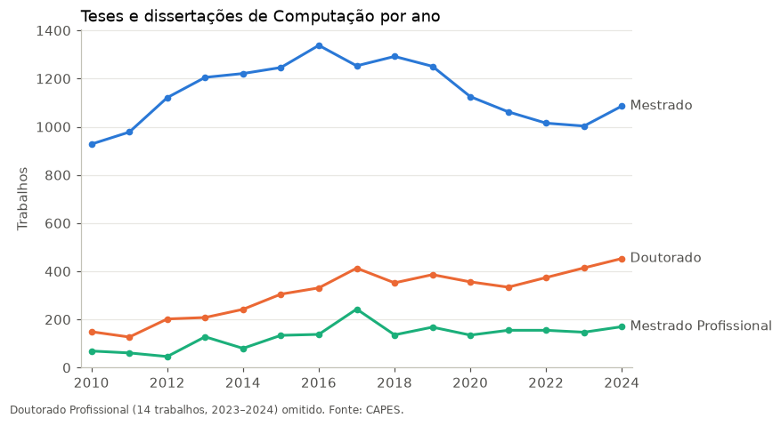
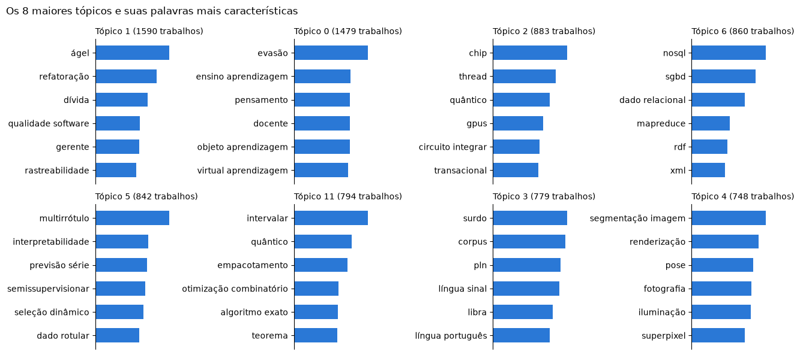
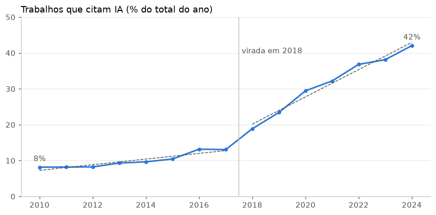
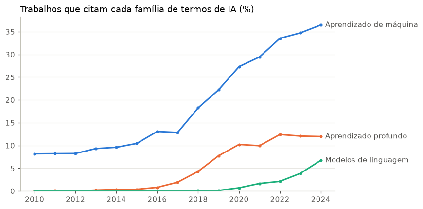
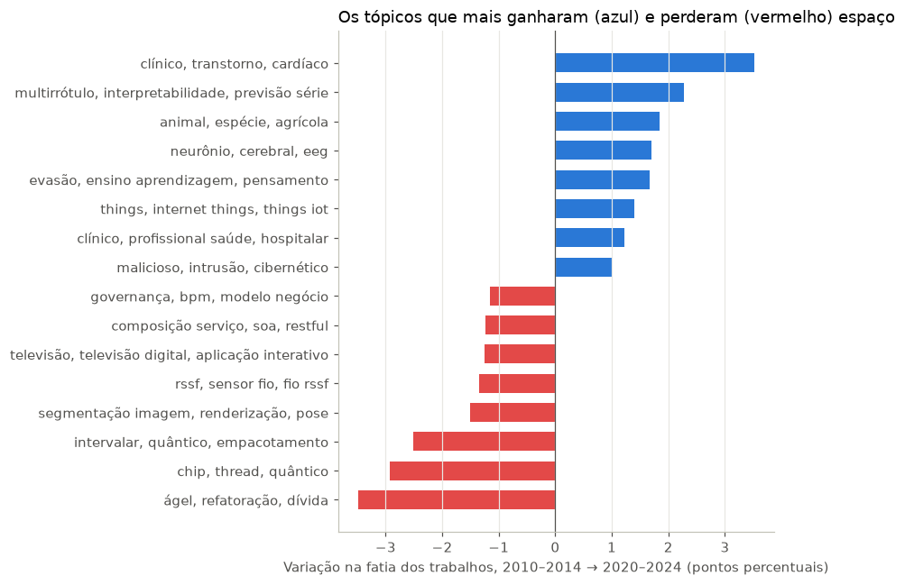
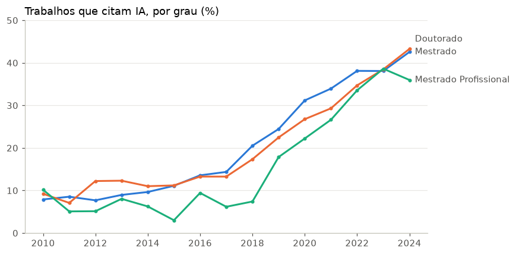
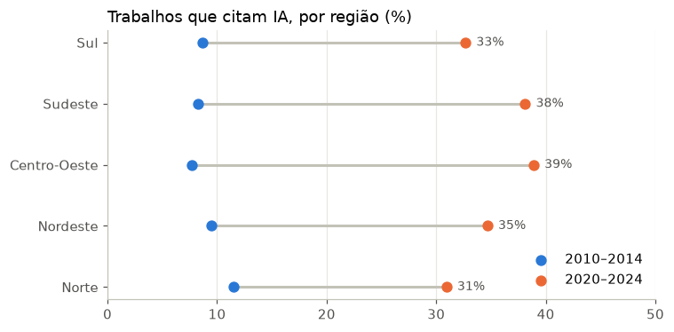
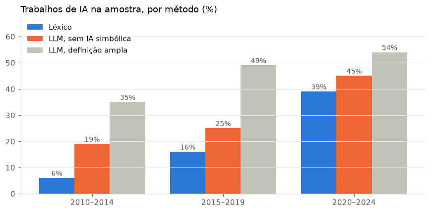
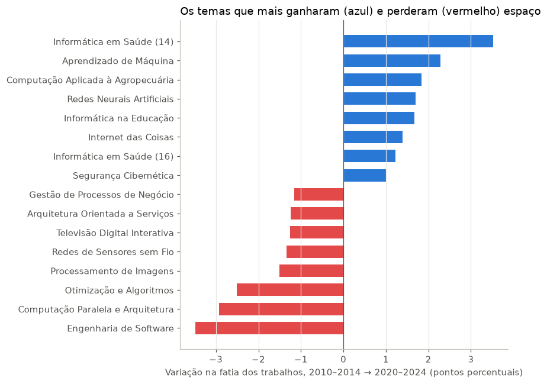

# Evolução temática das teses e dissertações de Computação no Brasil (2010–2024)

Como mudaram os temas da pós-graduação brasileira em Computação nos últimos 15 anos? Este projeto
analisa os resumos de teses e dissertações do **Catálogo de Teses e Dissertações da CAPES**, que são dados
abertos, para responder:

- Quais temas ganharam e quais perderam espaço entre 2010 e 2024?
- Quando a Inteligência Artificial e o Machine Learning viraram tendência dominante?
- Há diferença entre mestrado e doutorado?
- E entre as regiões do país?

## Backlog/Roadmap

- [X] Coleta dos dados abertos da CAPES
- [X] Limpeza e consolidação da base de Computação (2010–2024)
- [X] Pré-processamento dos resumos (NLP)
- [X] Modelagem de tópicos (BERTopic, com LDA como baseline)
- [X] Análise temporal e estatística
- [X] Classificação de trabalhos de IA com LLM, comparada ao léxico
- [X] Nomes legíveis para os tópicos gerados por LLM
- [X] App interativo para explorar os resultados

## Estrutura

```
app/            app Streamlit para explorar os resultados
data/
  raw/          arquivos originais da CAPES (não versionados)
  processed/    bases tratadas
notebooks/      análises, em ordem de execução
src/            scripts de coleta e tratamento
reports/
  figures/      gráficos gerados
```

## Como rodar

Requer Python 3.10 ou superior.

```bash
python -m venv .venv
source .venv/bin/activate         # Para Windows é: .venv\Scripts\activate
pip install -r requirements.txt
python -m spacy download pt_core_news_sm
```

### 1. Baixar os dados

```bash
python src/download_capes.py
```

O script baixa os arquivos do Catálogo de Teses e Dissertações direto do portal de dados
abertos da CAPES, um CSV por ano, de 2010 a 2024, e salva em `data/raw/` com o nome padrão `capes_<ano>.csv`.
O download completo pode demorar. Para testar com menos dados, escolha os anos:

```bash
python src/download_capes.py --anos 2023          # só 2023
python src/download_capes.py --anos 2022 2023     # 2022 e 2023
```

Arquivos que já foram baixados são pulados, então dá para interromper e rodar de novo depois.
Para baixar de novo mesmo assim, é necessário usar `--forcar`.

### 2. Montar a base de Computação

```bash
python src/build_dataset.py
```

O script lê os CSVs de cada ano em `data/raw/`, padroniza os nomes das colunas, mantém só os trabalhos da área de avaliação
**Ciência da Computação**, remove trabalhos sem resumo e duplicados, e grava o resultado em
`data/processed/teses_computacao_2010_2024.csv.gz`.

No final, mostra quantos trabalhos ficaram por ano e por grau.

>**Observação:** a partir de 2024, a CAPES passou a chamar a área de avaliação de
>"Computação" (antes era "Ciência da Computação"). O script considera os dois nomes.

### 3. Pré-processar os resumos

```bash
python src/preprocess.py
```

Marca os resumos que ficam fora da análise de texto e gera duas versões de cada resumo: `texto_limpo`, em minúsculas, para o
BERTopic e o LLM, e `texto_lematizado`, só com substantivos, adjetivos e verbos na forma base e
sem palavras genéricas de texto acadêmico, para o LDA.


### 4. Gerar os embeddings

```bash
python src/embeddings.py
```

Transforma cada resumo num vetor de 384 números que representa seu sentido, com o modelo
multilíngue `paraphrase-multilingual-MiniLM-L12-v2`. É a etapa mais lenta e grava `data/processed/embeddings.npz`, que não é versionado. 
Em computadores com pouca memória, feche outros programas antes de rodar.

### 5. Configurar o Gemini

As etapas com LLM usam a API do Gemini. Crie uma chave gratuita no
[Google AI Studio](https://aistudio.google.com/apikey), copie o arquivo `.env.example` para `.env`
e cole a chave nele. O `.env` não é versionado.

```bash
cp .env.example .env
python src/classificar_llm.py   # classifica uma amostra de 300 resumos
python src/nomear_topicos.py    # dá nomes legíveis aos tópicos
```

Os dois scripts salvam cada resposta assim que ela chega. Se pararem no meio (por limite de
uso da API, por exemplo), basta rodar de novo que eles continuam de onde pararam.


## Exploração

O notebook [`notebooks/01_exploracao.ipynb`](notebooks/01_exploracao.ipynb) traz o primeiro
olhar sobre a base: **23.749 trabalhos** entre 2010 e 2024.



- O mestrado acadêmico atingiu o pico em 2016 e caiu até 2023, voltando a subir em 2024.
- O doutorado cresce quase todo ano: sua participação no total dobrou, de 13% para 26%.
- O Sudeste concentra 43% dos trabalhos, enquanto Norte e Centro-Oeste, juntos, menos de 10%.


## Modelagem de tópicos

O notebook [`notebooks/02_modelagem_topicos.ipynb`](notebooks/02_modelagem_topicos.ipynb) descobre
os temas dos trabalhos sem rótulos prévios. O **BERTopic** agrupa os resumos pelo sentido e
encontrou **65 tópicos**, o **LDA**, método clássico baseado só na contagem de palavras, serve de
comparação com o mesmo número de tópicos.



| Modelo | Coerência (NPMI) | Diversidade |
|---|---|---|
| BERTopic | 0,171 | 0,825 |
| LDA | 0,059 | 0,817 |

A coerência mede se as palavras principais de um tópico aparecem juntas nos mesmos resumos. O
BERTopic gera temas muito mais nítidos e também um pouco mais
distintos entre si. O LDA tende a misturar assuntos dentro de um mesmo tópico.

Um achado: **não existe um tópico único de Inteligência Artificial**. Aprendizado de máquina
aparece como ferramenta espalhada por vários temas de aplicação. Medir a evolução da IA exige outra abordagem, 
que é o foco das próximas etapas.

**Limitações conhecidas:** o modelo pequeno do spaCy erra alguns lemas (por exemplo, "nuvem" vira
"nuver" em parte dos casos), e o nome da cidade de Pelotas aparece como "pelota" em alguns
tópicos. Os temas continuam reconhecíveis, mas um modelo de lematização maior melhoraria as
palavras-chave.


## Análise temporal

O notebook [`notebooks/03_analise_temporal.ipynb`](notebooks/03_analise_temporal.ipynb) responde
às perguntas centrais do projeto. Como a IA não forma um tópico próprio, cada trabalho é marcado
por um léxico de termos técnicos ([`src/lexico_ia.py`](src/lexico_ia.py)), dividido em três
famílias: aprendizado de máquina, aprendizado profundo e modelos de linguagem.


### Quando a IA virou tendência



A fração de trabalhos que citam IA passou de **8% em 2010 para 42% em 2024**. O ponto de virada
é **2018**: antes, a fatia crescia 0,8 ponto percentual por ano; depois, **3,8 pontos por ano**,
quase cinco vezes mais rápido. O ano foi encontrado testando cada ano como início de uma nova
fase e escolhendo o que melhor separa a série em duas retas.

Esse valor é um piso: a auditoria da seção [LLM × léxico](#llm--léxico) mostra que o léxico
deixa de fora parte dos trabalhos de IA.



O crescimento veio em três ondas: o aprendizado de máquina cresce o período todo; o aprendizado
profundo aparece por volta de 2017 e se estabiliza em cerca de 12% desde 2022; e os modelos de
linguagem surgem em 2020 e são os que mais crescem no fim da série (de 0,7% para 6,7% dos
trabalhos).

### Temas que ganharam e perderam espaço



Comparando 2010–2014 com 2020–2024, ganharam espaço aplicações em **saúde**, os **métodos de
aprendizado de máquina**, **agricultura**, **neurociência computacional**, **blockchain e
criptografia**, **educação** e **IoT**. Perderam espaço **engenharia e qualidade de software**,
**otimização combinatória e lógica**, **programação paralela e hardware**, **redes de sensores**,
**serviços web** e **TV digital**.

### Mestrado × doutorado e regiões



No período todo, o doutorado tem mais trabalhos de IA que o mestrado (23% contra 20%). Mas,
ano a ano, as curvas andam juntas: em 2020–2024, o mestrado tem até um pouco mais (37% contra
35%). A diferença no total vem da composição: o doutorado cresceu justamente nos anos em que a
IA se espalhou.



Entre 2010 e 2014, todas as regiões tinham de 8% a 12% de trabalhos de IA. Em 2020–2024, a
diferença aparece e é estatisticamente significativa (qui-quadrado, p < 0,001): **Centro-Oeste
(39%) e Sudeste (38%)** lideram, e o **Norte (31%)** fica atrás.

**Limitação:** o léxico identifica trabalhos que *citam* termos de IA no resumo. Um trabalho
pode usar IA sem citar nenhum desses termos, ou citá-los só como contexto. A seção a seguir
compara o léxico com um LLM, que lê o sentido do resumo, e não só as palavras.


## LLM × léxico

O notebook [`notebooks/04_llm_vs_lexico.ipynb`](notebooks/04_llm_vs_lexico.ipynb) testa uma
pergunta que o artigo não respondia: **um LLM identifica trabalhos de IA melhor que um léxico de
palavras?** Uma amostra de 300 resumos (20 por ano) foi classificada pelo Gemini, que lê o resumo
inteiro e diz se o trabalho usa IA, qual o papel dela e de que família ela é.

**A definição de IA muda tudo.** O LLM usa uma definição ampla, que inclui IA simbólica
(metaheurísticas, lógica fuzzy, sistemas especialistas). O léxico mede só IA baseada em
aprendizado (aprendizado de máquina, aprendizado profundo e modelos de linguagem), que é a onda
que este projeto investiga. Para comparar os dois com a mesma régua, a IA simbólica sai da conta
do LLM.

| | Concordância com o léxico | Kappa de Cohen |
|---|---|---|
| LLM, definição ampla | 72% | 0,41 |
| LLM, sem IA simbólica | 87% | 0,67 |

**Auditoria humana.** Li os 85 resumos em que o léxico e o LLM discordam e marquei se cada
trabalho usa IA baseada em aprendizado. O critério: o trabalho constrói, a partir de dados, algo
que classifica, agrupa ou prevê? A técnica sozinha não decide. Um algoritmo genético que otimiza
uma rota não conta, mas um que gera as regras de um classificador a partir de dados conta.
Agrupamento (clustering) conta, e regras de associação sozinhas não.

| Método | Acerto nas discordâncias |
|---|---|
| Léxico | 67% |
| LLM, definição ampla | 33% |
| **LLM, sem IA simbólica** | **82%** |

Com a mesma definição, o LLM acerta mais que o léxico. Os erros do léxico são quase todos num
sentido só: trabalhos de aprendizado de máquina descritos com palavras que ele não conhece. Ou
seja, **o léxico é confiável quando marca IA, mas subestima o total**.

**O que isso muda na análise temporal.** Os dois métodos mostram a IA crescendo, mas em ritmos
diferentes:

| Período | Léxico | LLM, sem IA simbólica |
|---|---|---|
| 2010–2014 | 6% | 19% |
| 2015–2019 | 16% | 25% |
| 2020–2024 | 39% | 45% |



A diferença entre os dois é maior no começo da série e diminui com o tempo. Uma explicação
provável é que o vocabulário dos trabalhos de IA mudou: os mais antigos falavam em "classificação"
e "mineração de dados", termos que o léxico não capta, e os recentes usam termos como "aprendizado
profundo", que ele capta. Assim, a ascensão da IA é real, mas o léxico exagera seu tamanho: pelo
LLM, a fatia cresce cerca de 2,4 vezes, e não 6,5. Com 100 resumos por período, cada porcentagem
tem margem de erro de cerca de ±9 pontos, então esses números indicam a direção, não valores
exatos.

**Tópicos com nomes.** Os tópicos do BERTopic também ganharam nomes legíveis, gerados pelo LLM a
partir das palavras e de títulos de cada tópico (`reports/topicos_nomeados.csv`). Quando dois
tópicos recebem o mesmo nome, o número do tópico é acrescentado para diferenciá-los.



Os temas que mais cresceram são aplicações da computação a outras áreas (saúde, agropecuária,
educação) e o próprio aprendizado de máquina. Os que mais perderam espaço são temas clássicos,
como engenharia de software, computação paralela e otimização.

**Decisões de engenharia:** saída em JSON validada por esquema (Pydantic), `temperature=0` para
respostas estáveis, 10 resumos por chamada para economizar cota, novas tentativas com espera
crescente quando a API recusa, limite de tempo por chamada e cache das respostas para retomar sem
repetir chamadas.


## Contexto

Projeto ligado ao artigo escrito em coautoria com Júlia Paulo Amorim na disciplina de Técnicas de Apresentação
Científica (UnB). Esta é a minha implementação do pipeline e das extensões com LLM.

## Dados

[Catálogo de Teses e Dissertações – Dados Abertos CAPES](https://dadosabertos.capes.gov.br/group/catalogo-de-teses-e-dissertacoes-brasil).

## Autoria

- **Implementação:** Letícia Gonçalves Bomfim, Ciência da Computação, Universidade de Brasília
- **Artigo:** Letícia Gonçalves Bomfim e Júlia Paulo Amorim, Universidade de Brasília